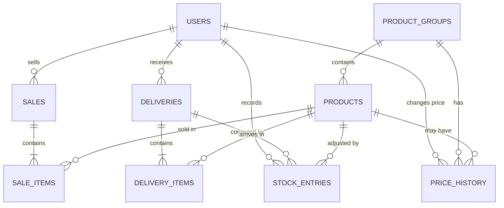

# Depot Management System: Database Design (Version 1)

## Core idea
- **Price lives on the item** (product group: Soda, Biscuit, Water...). A **sub-item** (product) may have its **own price**; if it does not, it uses the item price.
- **Stock lives on the sub-item** (Fanta, Chocolate...). Stock is counted per sub-item.
- **Sales and deliveries each use a header table + an items table**, because one sale or one delivery contains many products.
- **Receipts keep the price at the time of sale** (unit_price is copied into sale_items).
- **History is never edited.** Corrections and adjustments are new rows in `stock_entries`.

## Diagram (Mermaid)

## Tables

### users
| Column | Type | Notes |
|---|---|---|
| id | integer, primary key | |
| full_name | text | |
| username | text, unique | used to log in |
| password_hash | text | never store the plain password |
| role | text | `owner` or `shopkeeper` |
| failed_attempts | integer | wrong passwords in a row; reset to 0 on success |
| is_locked | boolean | set true at 3 failed attempts; owner unlocks |
| is_active | boolean | deactivate instead of deleting |

### product_groups (items)
| Column | Type | Notes |
|---|---|---|
| id | integer, primary key | |
| name | text, unique | e.g. Soda, Biscuit, Water ndogo, Water kubwa |
| current_price | integer | default price for its sub-items (whole TSh) |
| is_active | boolean | |

### products (sub-items)
| Column | Type | Notes |
|---|---|---|
| id | integer, primary key | |
| group_id | foreign key -> product_groups | |
| name | text | e.g. Fanta, Chocolate |
| own_price | integer, **nullable** | null = use group price. If set, this price is used |
| quantity_in_store | integer | never below 0; **kept** when the sub-item is stopped |
| min_level | integer | low-stock level |
| is_active | boolean | false = stopped selling; true again = "Bring back" |

Effective price = `own_price` if not null, otherwise `group.current_price`. A brand-new sub-item starts with quantity 0.

### price_history
| Column | Type | Notes |
|---|---|---|
| id | integer, primary key | |
| group_id | foreign key, nullable | set when the item price changed |
| product_id | foreign key, nullable | set when a sub-item's own price changed |
| price | integer, nullable | new price (null when own price was removed) |
| changed_at | datetime | |
| changed_by | foreign key -> users | owner only |

Exactly one of group_id or product_id is set.

### deliveries (stock received)
| Column | Type | Notes |
|---|---|---|
| id | integer, primary key | |
| delivered_at | date | the restocking day |
| received_by | foreign key -> users | owner or shopkeeper |
| note | text, optional | |

### delivery_items
| Column | Type | Notes |
|---|---|---|
| id | integer, primary key | |
| delivery_id | foreign key -> deliveries | |
| product_id | foreign key -> products | |
| quantity | integer | greater than 0 |
| buying_price | integer, **nullable** | per unit; entered by the owner only, hidden from shopkeepers; for future profit reports |

### stock_entries (corrections and adjustments)
| Column | Type | Notes |
|---|---|---|
| id | integer, primary key | |
| product_id | foreign key -> products | |
| delivery_id | foreign key, nullable | set when this corrects a delivery |
| kind | text | `correction` or `adjustment` |
| quantity_change | integer | signed: -2 removes 2, +3 adds 3 |
| reason | text | required. For adjustments: Damaged, Expired, Lost or missing, Counted differently |
| created_by | foreign key -> users | owner only |
| created_at | datetime | |

The store quantity is changed by `quantity_change` in the same transaction. The row is never edited or deleted.

### sales
| Column | Type | Notes |
|---|---|---|
| id | integer, primary key | |
| sold_at | datetime | |
| sold_by | foreign key -> users | owner or shopkeeper |
| payment_method | text | `cash` or `mobile_money` |
| total | integer | sum of line totals |

### sale_items
| Column | Type | Notes |
|---|---|---|
| id | integer, primary key | |
| sale_id | foreign key -> sales | |
| product_id | foreign key -> products | |
| quantity | integer | greater than 0 |
| unit_price | integer | the effective price at the time of sale |
| line_total | integer | quantity x unit_price |

## Rules the database and code must enforce
1. quantity_in_store can never go below 0.
2. Confirming a sale reduces stock for every item in one all-or-nothing transaction. The server re-checks stock and recalculates prices and totals.
3. Recording a delivery increases stock for every item in one transaction.
4. Changing a price adds a price_history row and updates the price. Old sale_items are never touched.
5. A correction or adjustment adds a stock_entries row and changes stock in one transaction. A reason is required. History is never edited.
6. Owner only: add or edit items and sub-items, change prices, stop or bring back, buying prices, corrections, adjustments, money totals, unlock users.
7. Owner and shopkeeper: sell, receive stock (quantities), view store balance.
8. Low-stock: LOW when quantity_in_store <= min_level and > 0; OUT when 0.
9. Stopped sub-items (is_active = false) cannot be sold or received, but keep their stock and history.
10. Nothing is hard-deleted.
11. Login: each wrong password adds 1 to failed_attempts; at 3 the user is locked. Success resets the count.

## Example data
| Item (price) | Sub-items |
|---|---|
| Soda (1,000) | Coca-Cola, Fanta, Sprite |
| Biscuit (500) | Chocolate, Vanilla |
| Water ndogo (500) | Water ndogo |
| Water kubwa (own price 1,500) | Water kubwa |

## Parked (not in Version 1)
Tax authority (TRA) and VAT fields, van stock, customers and debts, expenditure.
